# Guía Paso a Paso: Arquitectura Actual del Sistema con el Modelo C4

Esta guía complementa el `README.md` del taller. Cubre los dos entregables de la Parte 1 y la Parte 2: la **vista de contexto (C1)** y la **vista de contenedores (C2)** del modelo C4, ambas construidas sobre el caso base de RedExpress.

Los diagramas de ejemplo de esta guía están escritos en [Mermaid](https://mermaid.js.org/) y se renderizan automáticamente al ver este archivo en GitHub. Úselos como referencia de método — el entregable final debe hacerse en draw.io o Astah UML según lo indicado en el `README.md`.

---

## Parte A — Vista de Contexto (C1)

### A.1 Leyenda de notación C1

| Elemento | Forma / color | Uso |
|---|---|---|
| Persona (actor) | Óvalo azul | Alguien que interactúa directamente con el sistema |
| Sistema en alcance | Rectángulo azul oscuro | El sistema que se está documentando (una sola caja, sin desglosar) |
| Sistema externo | Rectángulo gris de doble borde | Sistema de un tercero, fuera del control del equipo |
| Relación | Flecha etiquetada | Qué información o función se intercambia, con verbo explícito |

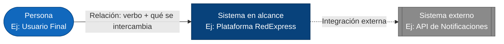

### A.2 Metodología en 4 pasos

1. **Identificar actores** — liste las personas o roles que interactúan directamente con el sistema.
2. **Identificar el sistema en alcance y los sistemas externos** — dibuje el sistema que se está documentando como una sola caja, y ubique aparte los sistemas de terceros con los que se conecta.
3. **Trazar relaciones** — conecte cada actor y cada sistema externo con el sistema en alcance, según quién interactúa con quién.
4. **Etiquetar relaciones y validar** — indique qué se intercambia en cada relación y confirme que ningún actor o sistema quede sin conexión.

### A.3 Ejemplo guiado: Contexto de RedExpress

#### Paso 1 — Identificar actores

Del caso base se extraen los tres actores humanos: **Usuario Final** (rastrea sus envíos), **Mensajero** (actualiza el estado de las entregas) y **Operador Logístico** (gestiona rutas y despachos).

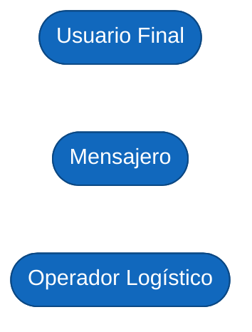

#### Paso 2 — Identificar el sistema en alcance y los sistemas externos

Se dibuja **Plataforma RedExpress** como el sistema en alcance (una sola caja, sin desglosar sus módulos internos todavía) y se identifican dos sistemas externos con los que se integra: la **API de Notificaciones** y el **Proveedor de Geolocalización**, ambos servicios de terceros.

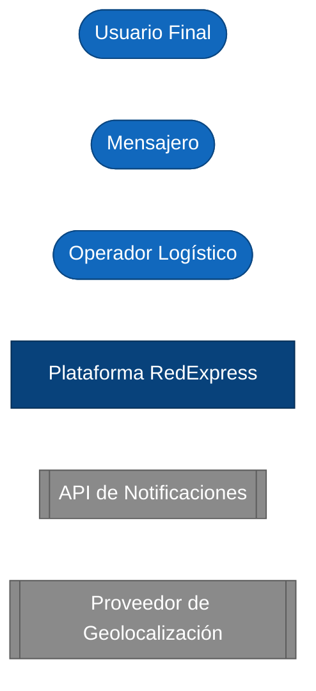

#### Paso 3 — Trazar relaciones

Se conecta cada actor con la plataforma y la plataforma con cada sistema externo. En este paso todavía no se explica qué viaja por cada relación — solo se establece quién se conecta con quién.

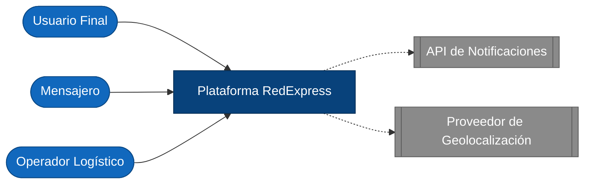

#### Paso 4 — Etiquetar relaciones y validar

Se etiqueta cada flecha con el verbo y la información que se intercambia. El diagrama queda validado cuando cada actor y cada sistema externo tiene una relación clara con la plataforma.

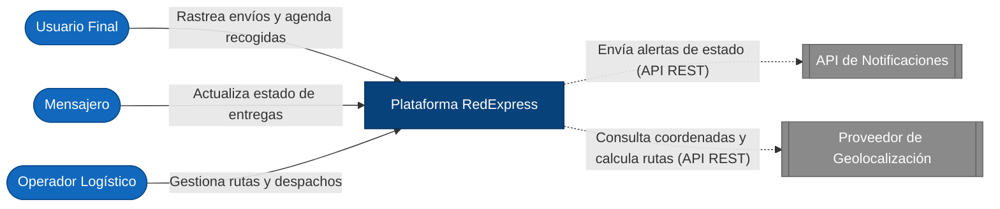

### A.4 Errores comunes en C1

| Error frecuente | Por qué es un problema | Cómo corregirlo |
|---|---|---|
| Dibujar los contenedores internos (apps, servicios) directamente en el C1 | Mezcla dos niveles de abstracción distintos | Deje los contenedores para el C2; en el C1 el sistema en alcance es una sola caja |
| No distinguir sistemas externos de sistemas propios | El lector no puede saber qué está bajo control del equipo y qué es de un proveedor | Use una forma/color distinto para sistemas externos (ver leyenda) |
| Relaciones sin etiqueta | No se entiende qué información o función se intercambia | Etiquete cada flecha con un verbo + qué se intercambia |
| Incluir actores sin relación directa con el sistema | Satura el diagrama con información irrelevante para este nivel | Solo incluya actores con una relación directa y relevante |

---

## Parte B — Vista de Contenedores (C2)

### B.1 Leyenda de notación C2

| Elemento | Forma / color | Uso |
|---|---|---|
| Contenedor | Rectángulo azul claro | Una aplicación o servicio desplegable dentro del sistema, con su tecnología indicada |
| Infraestructura de soporte | Rectángulo/cilindro gris | Base de datos, balanceador u otro componente que da soporte a los contenedores |
| Relación | Flecha etiquetada | Protocolo o mecanismo de comunicación entre contenedores (REST, SQL, WebSocket, etc.) |

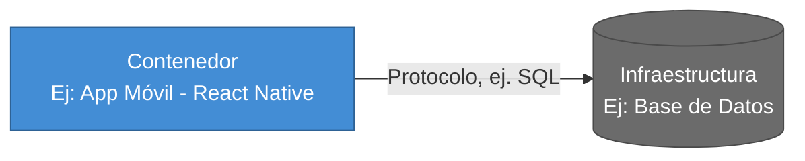

### B.2 Metodología en 4 pasos

1. **Descomponer el sistema en contenedores** — divida el sistema en alcance del C1 en las aplicaciones y servicios que realmente lo componen.
2. **Ubicar la infraestructura de soporte** — agregue los componentes compartidos (bases de datos, balanceadores) de los que dependen los contenedores.
3. **Trazar relaciones** — conecte los contenedores entre sí y con los actores/sistemas externos ya identificados en el C1.
4. **Etiquetar tecnología y protocolo, y validar** — indique con qué protocolo se comunica cada relación y confirme que cada contenedor tenga una responsabilidad clara y distinta de las demás.

### B.3 Ejemplo guiado: Contenedores de RedExpress

#### Paso 1 — Descomponer el sistema en contenedores

La **Plataforma RedExpress** del C1 se descompone en sus aplicaciones y servicios: **App Móvil**, **Portal Web Operadores**, **Módulo de Gestión de Paquetes**, **Motor de Rutas**, **Seguimiento GPS** y **Sistema de Alertas**. Aún no se conectan entre sí.

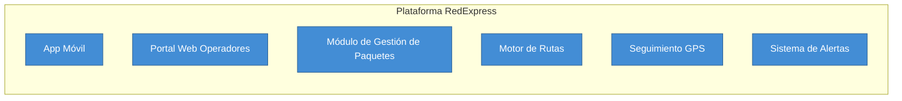

#### Paso 2 — Ubicar infraestructura de soporte

Se agregan el **Balanceador de Carga**, que distribuye el tráfico entrante, y la **Base de Datos Distribuida**, donde persiste la información de paquetes, rutas y usuarios.

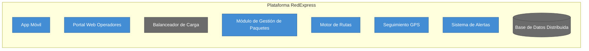

#### Paso 3 — Trazar relaciones

Se conectan los contenedores entre sí, y se retoman los actores y sistemas externos del C1 (Usuario Final, Mensajero, Operador Logístico, API de Notificaciones, Proveedor de Geolocalización) para mostrar con qué contenedor específico interactúa cada uno.

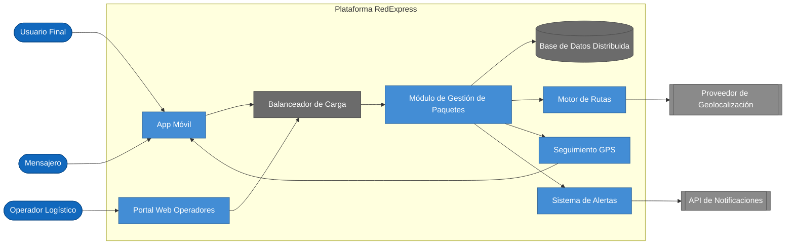

#### Paso 4 — Etiquetar tecnología/protocolo y validar

Se etiqueta cada relación con el protocolo o mecanismo de comunicación. El diagrama queda validado cuando cada contenedor tiene una responsabilidad clara y cada relación explica cómo se comunican.

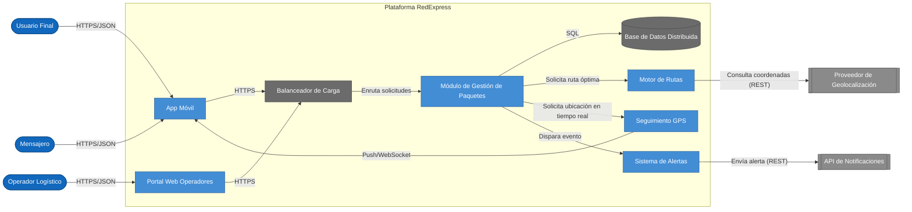

> Vea las dos vistas finales (C1 y C2) como un diagrama interactivo clickeable en [`clase/visualizacion-c4.html`](visualizacion-c4.html).

### B.4 Errores comunes en C2

| Error frecuente | Por qué es un problema | Cómo corregirlo |
|---|---|---|
| Contenedor sin tecnología indicada | El C2 pierde su propósito principal: mostrar decisiones tecnológicas | Indique la tecnología o el tipo de contenedor (ej. "SPA - React", "Servicio - Node.js") |
| Un solo contenedor gigante que hace de todo | Oculta la distribución real de responsabilidades del sistema | Divida por responsabilidad (gestión de paquetes, rutas, alertas, etc.) |
| Relaciones sin protocolo/tecnología | No se puede evaluar el diseño de comunicación entre contenedores | Etiquete cada relación con el protocolo (REST, SQL, WebSocket, etc.) |
| Mezclar actores del C1 con contenedores sin distinguirlos visualmente | Confunde el nivel de abstracción y quién es externo al sistema | Mantenga el estilo de nodo (persona/externo/contenedor) consistente con la leyenda |

---

## 4+1 como lista de verificación

C4 sirve para dibujar; el modelo de vistas 4+1 (Kruchten) sirve para verificar que no falta nada. Antes de dar por terminados el C1 y el C2, recorra las cinco vistas y pregúntese dónde queda cubierta cada una con lo que ya entregó:

| Vista 4+1 | Qué responde | Dónde debería estar en su entrega |
|---|---|---|
| Lógica | Qué hace el sistema: funcionalidad y entidades | Contenedores por responsabilidad en el C2 y el ERD del Taller 2 |
| Desarrollo | Cómo se organiza el código y en qué tecnología | Tecnología indicada en cada contenedor del C2 y decisiones registradas en `decisiones.md` |
| Proceso | Qué ocurre en tiempo de ejecución: flujos, concurrencia, comunicación | Relaciones etiquetadas con protocolo en el C2 y el BPMN del Taller 1 |
| Física | Dónde se despliega cada pieza | Se completa en el Taller 4 (infraestructura); aquí basta con la infraestructura de soporte del C2 |
| Escenarios | Casos de uso que atraviesan las otras cuatro vistas | Actores y relaciones del C1, y un flujo crítico narrado en el informe |

Si una vista no tiene dónde vivir, falta algo en el diagrama, en `decisiones.md` o en el informe. No hace falta dibujar cinco diagramas: hace falta poder responder las cinco preguntas con lo que ya se entregó.

---

## Checklist de autoevaluación antes de entregar

**Vista de Contexto (C1):**

- [ ] El sistema en alcance aparece como una única caja, sin contenedores internos visibles.
- [ ] Todos los actores relevantes están identificados y tienen al menos una relación.
- [ ] Los sistemas externos están visualmente diferenciados del sistema en alcance.
- [ ] Cada relación tiene una etiqueta que describe qué se intercambia.
- [ ] Ningún actor ni sistema queda sin conexión.

**Vista de Contenedores (C2):**

- [ ] Cada contenedor tiene su tecnología o tipo indicado.
- [ ] Los contenedores reflejan responsabilidades separadas — no hay un contenedor que "hace de todo".
- [ ] Los actores y sistemas externos del C1 se mantienen visibles y conectados en el C2.
- [ ] Cada relación entre contenedores indica el protocolo o mecanismo de comunicación.
- [ ] La infraestructura de soporte (balanceador, base de datos, integraciones) está representada.

---

## Vista ArchiMate equivalente

Los contenedores del C2 mapean casi 1:1 a **Application Components** de ArchiMate (ver la [Guía de Notación ArchiMate](https://github.com/CesarAVegaF312/AREM-ArchiMate/blob/main/guia_notacion_archimate.md)); las relaciones entre ellos usan **Serving** en vez de flechas genéricas.

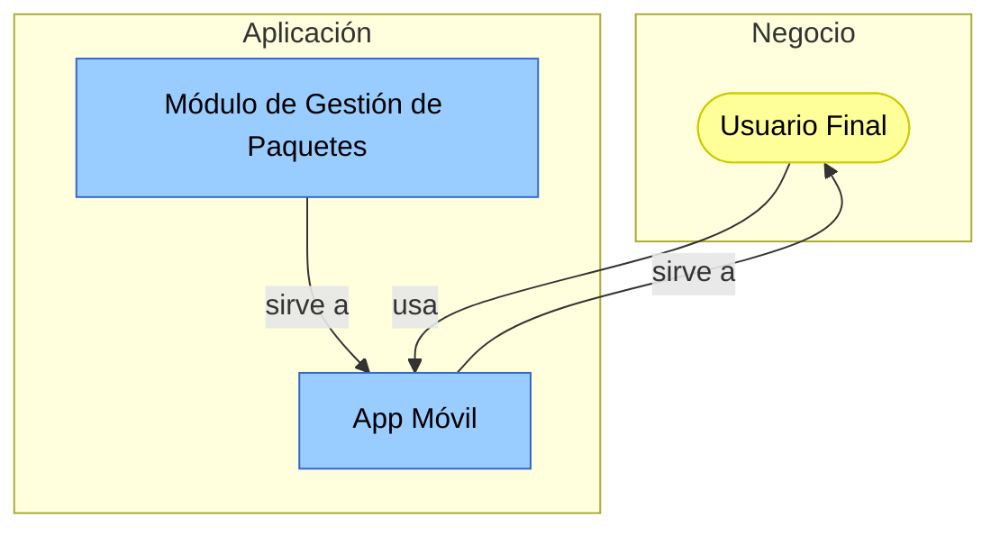

La diferencia con el C2 original: en C4 la relación se etiqueta con protocolo ("HTTPS/JSON"); en ArchiMate se etiqueta con el tipo semántico de relación (**Serving**). Ambas notaciones son válidas para el mismo contenedor — C4 responde "cómo se comunican técnicamente", ArchiMate responde "quién depende de quién en la arquitectura".

---

## Parte C — Validación técnica del modelo como código (opcional)

En draw.io, el C1 y el C2 son dos dibujos independientes: nada impide que digan cosas distintas, que una flecha apunte a una caja que no existe o que a una relación le falte el protocolo. Esta parte propone **comprobar el modelo** escribiéndolo una sola vez como código y dejando que una herramienta dibuje las dos vistas y revise su consistencia. No es un ejercicio de programación: el modelo del caso base ya está escrito en [`validacion-tecnica/workspace.dsl`](validacion-tecnica/workspace.dsl) y solo hay que leerlo y adaptarlo.

### C.1 Qué se necesita

- [Docker Desktop](https://www.docker.com/products/docker-desktop/) (o Docker Engine en Linux). La imagen de [Structurizr Lite](https://docs.structurizr.com/lite) pesa unos 400 MB.
- Un editor de texto para el archivo `.dsl` (VS Code, el Bloc de notas o cualquiera).

### C.2 Abrir el modelo del caso base

Desde la carpeta `clase/validacion-tecnica/`:

```bash
docker compose up        # luego abra http://localhost:8080 en el navegador
```

Aparecen las dos vistas, **C1-Contexto** y **C2-Contenedores**, dibujadas a partir del mismo archivo. Cada vez que se guarda un cambio en `workspace.dsl`, basta con recargar la página. Para terminar: `Ctrl+C` y luego `docker compose down`.

### C.3 Del diagrama al código

| En el diagrama | En `workspace.dsl` |
|---|---|
| Actor (persona) | `person "Nombre" "Descripción"` |
| Sistema externo | `softwareSystem "Nombre" "Descripción" "Externo"` |
| Sistema en alcance | `softwareSystem` con sus contenedores adentro, entre llaves |
| Contenedor | `container "Nombre" "Responsabilidad" "Tecnología"` |
| Relación | `origen -> destino "Verbo e información" "Protocolo"` |

La diferencia de fondo con draw.io: **el C1 no se dibuja, se deduce**. El archivo solo tiene las relaciones del C2 (entre contenedores, actores y sistemas externos), y Structurizr calcula a partir de ellas las flechas del C1. Por eso las dos vistas no pueden contradecirse.

### C.4 Qué revela la validación

Las tres pruebas siguientes se hicieron sobre el caso base y dan exactamente este resultado:

| # | Qué se hace | Qué muestra Structurizr | Qué significa |
|---|---|---|---|
| 1 | Agregar una relación hacia un contenedor que no existe, por ejemplo `redexpress.gestion -> redexpress.facturacion "Genera la factura del envío"` | No dibuja nada y muestra: `The destination element "redexpress.facturacion" does not exist at line 51` | Una flecha hacia una caja que nadie definió. En draw.io pasa desapercibida. |
| 2 | Borrar la relación `redexpress.rutas -> geolocalizacion` | El Proveedor de Geolocalización desaparece del C2 **y también del C1** | En el C1 de la guía hay una flecha hacia ese proveedor, pero si ningún contenedor lo usa, esa flecha no tiene respaldo. El C1 solo puede mostrar lo que el C2 justifica. |
| 3 | Abrir las inspecciones: el contador del panel izquierdo, o `http://localhost:8080/workspace/inspections` | 6 errores. Cuatro dicen que una relación entre contenedores no tiene tecnología: "Enruta solicitudes", "Solicita ruta óptima", "Solicita ubicación en tiempo real" y "Dispara evento" | El C2 final de la guía (Parte B, Paso 4) incumple su propia regla: "cada relación explica cómo se comunican". Al agregar el protocolo a esas cuatro relaciones, los errores bajan a 2. |

Los 2 errores que quedan dicen que el sistema no tiene documentación ni decisiones registradas en Structurizr. En este taller esas dos cosas viven en `entrega/informe.md` y `entrega/decisiones.md`, así que se pueden ignorar.

### C.5 Aplicarlo al cliente real

1. Copie la carpeta `validacion-tecnica/` a `entrega/validacion-tecnica/`.
2. Reescriba `workspace.dsl` con los actores, sistemas externos, contenedores y relaciones de su C1 y su C2 del cliente.
3. Corrija hasta que el modelo cargue sin errores de elementos inexistentes y las inspecciones solo muestren los 2 errores de documentación y decisiones.
4. Compare las vistas que dibuja Structurizr con sus diagramas de draw.io (los botones **PNG** y **SVG** de la barra superior exportan cada vista).
5. En `entrega/informe.md`, anote qué inconsistencias encontró entre el C1 y el C2 y qué cambió en los diagramas por eso.

Los diagramas en draw.io siguen siendo el entregable del taller; el `.dsl` es la forma de comprobarlos.

---

## Parte D — Análisis de caso real y panorama tecnológico (opcional)

### D.1 Caso: el servicio de monitoreo de Prime Video que pasó de microservicios a un monolito (2023)

**Qué pasó.** En marzo de 2023, el equipo de análisis de calidad de video de Amazon Prime Video publicó en su blog técnico cómo rediseñó la herramienta que monitorea la calidad de las transmisiones de audio y video. La primera versión estaba hecha de componentes distribuidos: funciones AWS Lambda coordinadas por AWS Step Functions, que se pasaban los datos intermedios a través del almacenamiento Amazon S3. Al crecer el número de transmisiones, el servicio alcanzó los límites de la cuenta y el costo se disparó, por las transiciones de estado de la orquestación y por la transferencia de datos a S3. El equipo juntó los componentes en un solo proceso que corre en Amazon EC2 y Amazon ECS, con los datos intermedios en memoria, y reportó una reducción de alrededor del 90 % en el costo de infraestructura.

El artículo generó un debate amplio. Varios analistas, entre ellos Adrian Cockcroft (exarquitecto de Netflix y exvicepresidente de AWS), señalaron que el cambio fue de un solo servicio y no de toda la plataforma, y que empezar con componentes serverless para validar la idea y luego optimizar fue una decisión razonable, no un error.

**Qué significa, en el lenguaje de este taller.** Es una decisión de C2: cuántos contenedores tiene el sistema. En la primera versión, cada etapa del monitoreo era un contenedor y cada flecha entre ellos cruzaba la red y pasaba por S3. En la segunda, esas etapas quedaron dentro de un solo contenedor y las flechas se convirtieron en llamadas en memoria. La pregunta de la Parte B ("¿qué se despliega por separado?") tiene consecuencias de costo y de operación, no solo de dibujo.

**Preguntas para el análisis.**

1. Dibuje un C2 aproximado de la versión distribuida y uno de la versión monolítica. ¿Cuántos contenedores y cuántas relaciones tiene cada uno?
2. En el C2 de RedExpress, el Módulo de Gestión de Paquetes llama al Motor de Rutas, a Seguimiento GPS y al Sistema de Alertas. ¿Qué ganaría y qué perdería RedExpress si los juntara en un solo contenedor?
3. Registre una de esas decisiones en `entrega/decisiones.md` con la [plantilla de decisiones](../plantillas/plantilla_decisiones.md): decisión, alternativas, razón y consecuencia.

**Fuentes.** [InfoQ, mayo de 2023](https://www.infoq.com/news/2023/05/prime-ec2-ecs-saves-costs/); [DevClass, 5 de mayo de 2023](https://devclass.com/2023/05/05/reduce-costs-by-90-by-moving-from-microservices-to-monolith-amazon-internal-case-study-raises-eyebrows/); [The Stack, sobre la opinión de Adrian Cockcroft](https://thestack.technology/prime-video-monolith-architecture-debate-bad-takes-adrian-cockcroft). El artículo original se publicó en el blog técnico de Prime Video (primevideotech.com); si lo cita, verifique que siga disponible.

### D.2 Panorama tecnológico

**Herramientas para documentar C4.**

| Herramienta | Cómo funciona | Conviene cuando |
|---|---|---|
| draw.io | Se dibuja a mano, con plantillas de formas C4 | Se quiere rapidez y el equipo no programa (es la herramienta del entregable) |
| Structurizr (Lite o en la nube) | Un modelo en texto, varias vistas generadas, inspecciones automáticas | Se quiere que C1 y C2 sean consistentes y versionar el modelo en Git (Parte C) |
| C4-PlantUML | Cada diagrama en texto, dibujado con PlantUML | El equipo ya usa PlantUML; cada diagrama es independiente, así que no hay deducción entre vistas |
| Mermaid (diagramas C4) | Texto dentro de archivos Markdown, GitHub lo dibuja directamente | Se quieren diagramas dentro de la documentación del repositorio. El soporte de C4 en Mermaid todavía está marcado como experimental |
| IcePanel | Herramienta visual en línea con un modelo único detrás | Se quiere la consistencia de un modelo sin escribir código; es un servicio comercial con plan gratuito limitado |

**Estilos de arquitectura en el C2.**

| Estilo | Cómo se ve en el C2 | Conviene cuando | Riesgo principal |
|---|---|---|---|
| Monolito | Un solo contenedor de aplicación y su base de datos | Equipo pequeño, dominio todavía cambiante, poco presupuesto de operación | Todo se despliega junto; una parte con mucha carga obliga a escalar todo |
| Monolito modular | Un solo contenedor, con módulos internos de límites claros (se ven en C3) | Se quiere la simplicidad del monolito sin perder orden interno | Que los límites entre módulos se respeten solo en el papel |
| Microservicios | Varios contenedores pequeños, cada uno con sus datos | Equipos independientes que necesitan desplegar y escalar por separado | Costo de red, de operación y de monitoreo; fallas en cadena entre servicios |
| Serverless | Funciones y servicios administrados del proveedor de nube | Cargas variables o esporádicas; se paga por uso | Costo difícil de prever cuando el uso crece (caso Prime Video) y dependencia del proveedor |

Ningún estilo es mejor en abstracto. La justificación tiene que salir del cliente: tamaño del equipo, volumen de uso, presupuesto y capacidad de operar lo que se construye. Esa comparación es la base del TO-BE del Taller 7.

### D.3 Aplicarlo al cliente real

1. Identifique qué estilo tiene hoy el sistema del cliente según su C2 (monolito, microservicios, mezcla).
2. Busque un caso público y documentado de un cambio de estilo de arquitectura (en cualquier dirección) en el sector del cliente o en una organización de tamaño similar.
3. Analícelo con la [plantilla de análisis de caso](../plantillas/plantilla_analisis_caso.md) y guárdelo en `entrega/analisis-caso.md`. En la sección 5, compare dos estilos de la tabla anterior para el sistema del cliente.

---

_Esta guía hace parte del Taller 3 de Arquitectura Actual del Sistema con el Modelo C4 — curso Arquitectura Empresarial, Universidad de La Sabana._
